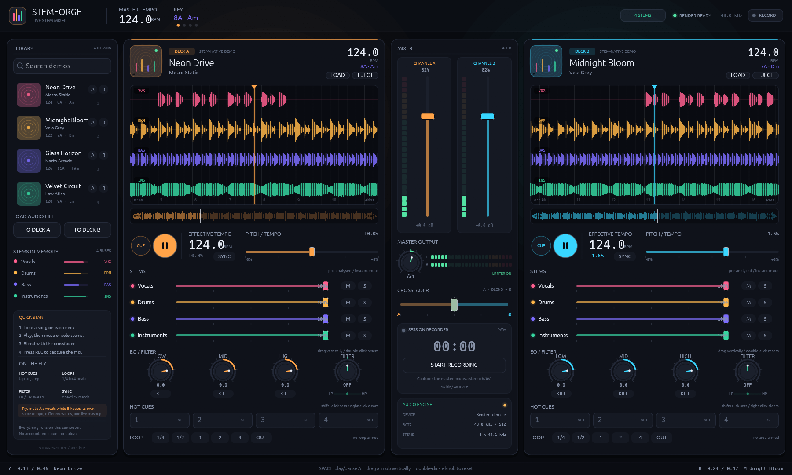

# STEMFORGE — Mezclador de stems en directo

Aplicación de escritorio para Windows, macOS y Linux que mezcla dos canciones a la vez y permite
silenciar o aislar la voz, la batería, el bajo y los instrumentos de cada tema al instante.

Hecha en Rust con `eframe`/`egui` (interfaz) y `cpal` + `symphonia` (audio). Todo se ejecuta en el
ordenador: no hay cuenta, nube ni conexión a internet.



## Funciones

- **Dos platos (A y B)** con carga de archivos MP3, WAV, FLAC, OGG, AAC/M4A y visualización de la
  forma de onda por stem.
- **Cuatro stems por plato** — voz, batería, bajo e instrumentos — con volumen, mute y solo
  independientes. El cambio se aplica al instante durante la reproducción.
- **Ecualizador de 3 bandas** (graves, medios, agudos) con botón *kill* por banda.
- **Filtro de barrido bipolar**: paso bajo a la izquierda, paso alto a la derecha, con resonancia.
- **Crossfader** con curva de igual potencia y medidores de nivel por canal.
- **Pitch / tempo** con rango ajustable y **sync** de tempo entre platos.
- **4 hot cues** por plato (saltar, fijar y borrar) y **loops** de 1/4, 1/2, 1, 2 y 4 beats.
- **Grabación** de la mezcla master a WAV estéreo de 16 bits / 48 kHz.
- **Cuatro temas de demostración** ya separados en stems, para probar sin cargar archivos.
- **Arranque silencioso**: la app abre en pausa y no reproduce hasta que pulses play.

## Cómo ejecutarlo

Necesitas [Rust](https://rustup.rs) instalado.

```bash
cd app
cargo run --release
```

Para compilar solo:

```bash
cargo build --release
```

El ejecutable queda en `target/release/stemforge`.

### Modo captura

Abre la ventana sin robar el foco, dibuja unos 120 fotogramas, guarda una imagen PNG y se cierra:

```bash
cargo run -- --screenshot shots/preview.png
```

## Controles

| Acción | Cómo |
| --- | --- |
| Reproducir / pausar un plato | Botón play o `Espacio` |
| Volver al cue | Botón *Cue* |
| Cambiar stems | Deslizador de volumen, `M` (mute) y `S` (solo) |
| Ecualizar | Ruedas Low / Mid / High; *Kill* silencia la banda |
| Filtrar | Rueda Filter: izquierda paso bajo, derecha paso alto |
| Mezclar | Crossfader central |
| Ajustar tempo | Deslizador *Pitch / Tempo* o botón *Sync* |
| Hot cues | Pads 1–4 (clic para saltar, `Set` para fijar, clic derecho para borrar) |
| Loops | Botones 1/4, 1/2, 1, 2, 4 y `Out` |
| Grabar sesión | Botón *Record*; al parar se guarda un WAV |
| Cargar canción | *Load* en cada plato o *To Deck A / B* en la biblioteca |

## Cómo se separan los stems

Los cuatro temas de demostración se generan con pistas sintetizadas por separado (voz, batería,
bajo y armonía), así que su separación es real y sin filtraciones.

En un archivo importado, la separación se hace en memoria dividiendo el espectro en cuatro bandas
aproximadas. Es inmediata y funciona sin GPU, pero **no es un modelo de IA entrenado**: puede haber
algo de sangrado entre stems, sobre todo entre voz e instrumentos melódicos. Un modelo HTDemucs /
ONNX descargable sería el siguiente paso natural.

## Requisitos y límites

- Audio a 48 kHz con búfer de 512 muestras; la latencia depende de la tarjeta de sonido.
- La grabación se guarda como WAV en la carpeta del proyecto.
- Probado compilando y dibujando en Windows; no se ha podido escuchar en altavoces físicos durante
  el desarrollo, así que la latencia real y los clics de buffer no están medidos.
- La interfaz es un diseño propio, no una copia de ningún programa comercial.

## Estructura

```
app/
├── Cargo.toml
├── src/
│   ├── main.rs      ventana, estado global, modo captura
│   ├── audio.rs     motor cpal, mezcla, filtros, grabación
│   ├── track.rs     decodificación, análisis y stems de demostración
│   ├── deck_ui.rs   plato, ondas, stems, EQ, hot cues, loops
│   ├── mixer.rs     crossfader, medidores y master
│   ├── library.rs   biblioteca y carga de archivos
│   └── widgets.rs   ruedas, pads, medidores y estilos
└── docs/preview.png
```

## Licencia

Publicado bajo la licencia MIT: puedes usarlo, modificarlo y compartirlo libremente, conservando el
aviso de copyright. Las canciones de demostración son composiciones sintéticas originales.

Consulta el archivo [LICENSE](LICENSE) para el texto completo.
